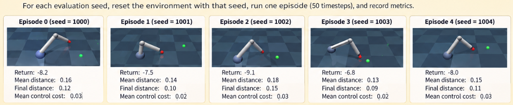
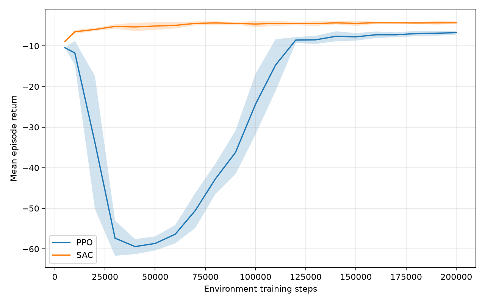
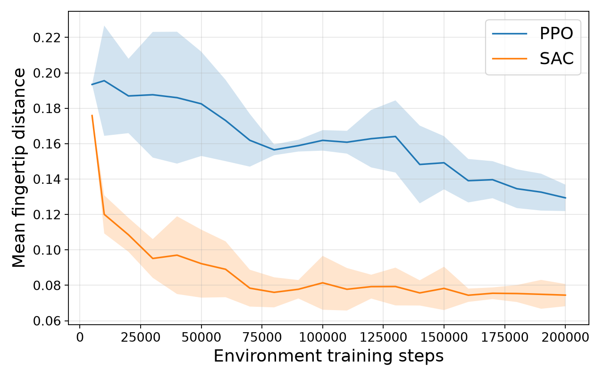
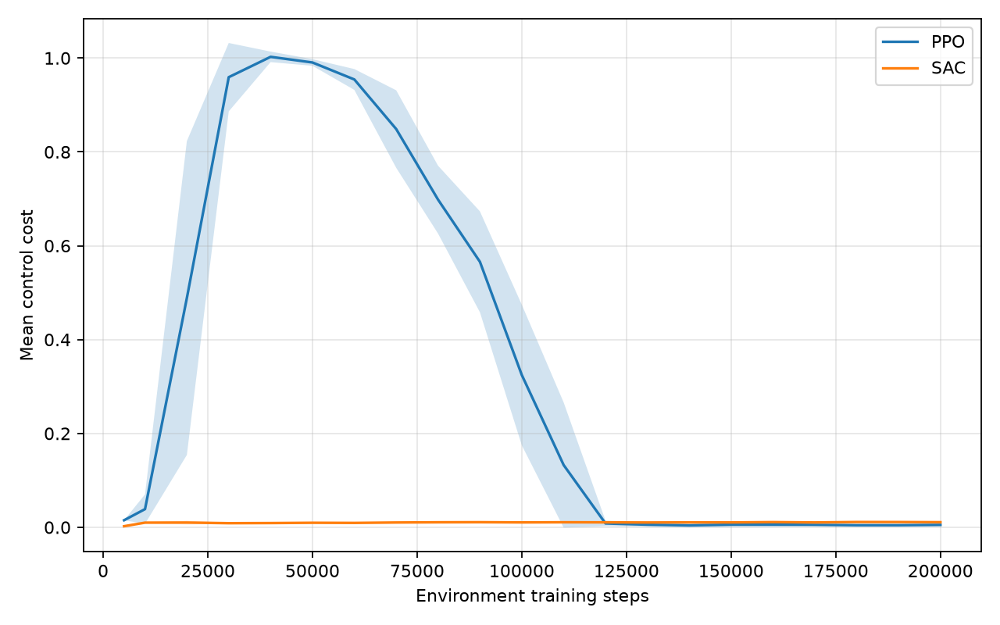

# PPO vs SAC on MuJoCo Reacher-v5 🤖

Goal of this project is comparing two reinforcement-learning approaches **PPO (on-policy)** and **SAC (off-policy)** with [Stable-Baselines3](https://stable-baselines3.readthedocs.io/) in [Gymnasium's Reacher-v5](https://gymnasium.farama.org/environments/mujoco/reacher/) to controlling a two-jointed robotic arm.

todo: put a viedo here


## 1. Introduction and Goals

Reacher-v5 models a **two-joint arm**. Each policy observes a **10-element observation** describing the arm's state and target geometry, and outputs **2 bounded joint-torque commands** in `[-1, 1]`.


Given the same number of **environment interactions**, how do PPO and SAC compare at reaching a target in Reacher-v5?

We compare:

- **Learning progress:** average evaluation return vs. environment steps.
- **Reaching precision:** mean and final fingertip-to-target distance (lower is better).
- **Control effort:** mean penalized torque cost (lower means less action magnitude).
- **Variability:** results across independent training seeds, each evaluated on identical episode-reset seeds.

Training on CPU is supported.

## 2. The robotics / RL problem
Markove decision process consist of (State, Action, Transition function, Reward) that has been described in below.

### 2.1. Observation Space (State)
The agent receives a 10-dimensional continuous observation vector:

$$
s_t =
\begin{bmatrix}
\cos(\theta_1), &
\cos(\theta_2), &
\sin(\theta_1), &
\sin(\theta_2), &
x_g, &
y_g, &
\dot{\theta}_1, &
\dot{\theta}_2, &
\Delta x, &
\Delta y
\end{bmatrix}
$$

Notes:

Joint angles ($\theta_1$, $\theta_2$): The angular positions of the two joints.

Joint velocities ($\dot{\theta}_1$, $\dot{\theta}_2$): The angular velocities of the joints, measured in radians per second.

Target coordinates ($x_g$, $y_g$): The target's position in the coordinate system.

Position differences ($\Delta x$, $\Delta y$): The difference between the fingertip position and the target position, calculated as:

$$
\Delta x = x_{\text{fingertip}} - x_g
$$

$$
\Delta y = y_{\text{fingertip}} - y_g
$$


### 2.2. Action Space
The agent controls the robotic arm by applying torque to its two joints. 

$$
a_t = [\tau_1,\tau_2]
$$

Where:

$\tau_1$: Torque command for the first joint.


$\tau_2$: Torque command for the second joint.

The action is a 2-dimensional continuous vector, so that its space is defined as:

Box(-1.0, 1.0, (2,), float32)

### 2.3. Transition Space Shaping

The MuJoCo simulator then calculates how these torques affect the robot's position and velocity.
The RL agent does not directly specify the desired joint angles or fingertip position. It learns to control the robot indirectly through torque commands.

### 2.4. Reward
The goal is to move the robot's fingertip close to the target while avoiding unnecessarily large control inputs.

The default Reacher-v5 reward combines two components:
$$
{r_t = r_{\text{distance}} + r_{\text{control}}}
$$

#### 2.4.1. Distance Reward
The distance reward measures how close the fingertip is to the target:

$$
r_{\text{distance}} =
-\sqrt{(x_f-x_g)^2+(y_f-y_g)^2}
$$

Where:

$(x_f,y_f)$: Fingertip position.

$(x_g,y_g)$: Target position.

The distance is measured in meters and the negative sign means that the agent receives a larger reward when the fingertip is closer to the target.

#### 2.4.2. Control Penalty

The control penalty discourages the agent from applying unnecessarily large torques:

$$
r_{\text{control}} =
-0.1(\tau_1^2+\tau_2^2)
$$

Where:

$(\tau_1,\tau_2)$: Actions applied to the two joints.

$(0.1)$: Default control penalty weight.

The penalty increases as the magnitude of the applied torque increases. This encourages the policy to reach the target using smaller control inputs when possible.

#### 2.4.2. Total Reward

Combining the distance and control components gives the default reward function. The agent learns to maximize cumulative reward, which encourages reaching the target while limiting control effort.

$$
{
r_t =
-\sqrt{(x_f-x_g)^2+(y_f-y_g)^2}
-0.1(\tau_1^2+\tau_2^2)
}
$$


## 3. PPO vs SAC: conceptual comparison

| Property | PPO | SAC |
|---|---|---|
| Data collection | On-policy | Off-policy with replay buffer |
| Policy optimization | Clipped policy-gradient objective | Entropy-regularized actor-critic |
| Experience reuse | Limited (latest rollout) | Reuses past transitions |
| Continuous actions | Yes | Yes |
| Memory requirement | Relatively modest | Replay buffer costs more RAM |


**Fair-comparison scope:** same task, reward, network hidden-layer sizes (`[64, 64]`), device (`cpu`), training-step budget and evaluation seeds. 

## 4. Repository structure

```text
reacher-ppo-vs-sac/
├── README.md                  # Walkthrough and analysis instructions
├── requirements.txt           # Python dependencies
├── scripts/
│   ├── common.py              # Reacher env, rollouts, checkpoint evaluator
│   ├── train.py               # PPO/SAC training
│   ├── evaluate.py            # Held-out final evaluation
│   ├── plot.py                # Learning curves + final performance table
│   └── watch.py               # Visualize a saved policy
├── tests/test_smoke.py        # Quick integration smoke test
├── models/                    # Generated model ZIPs (ignored by Git)
└── results/                   # Generated CSVs and PNGs (ignored by Git)
```

## 5. Set up Requirments

Recommended: **Python 3.10–3.12**, an up-to-date operating system, ~8 GB+ RAM. For the first run, a CPU is sufficient. MuJoCo installs through Gymnasium's extra.

### Linux

```bash
python3 -m venv .venv
source .venv/bin/activate
python -m pip install --upgrade pip
python -m pip install -r requirements.txt
```


## 6. Step-by-step experiments


### Step A — Training experiments (three seeds)

Training happens *without rendering* to keep it fast. 
The Neural Network has 2 layers with this amount of neurons: [64, 64].
The default duration of an episode is 50 timesteps.

```bash
python scripts/train.py --alg both --steps 200000 --eval-freq 10000 --seeds 0 1 2
```

<p align="center">

[//]: # (  )
  
</p>




```bash
python scripts/evaluate.py --alg both --seeds 0 1 2 --episodes 30
python scripts/plot.py
```
<p align="center">
  
  
</p>
 The same **30 held-out evaluation seeds** (20000–20029) are applied to every final model. Periodic checkpoints use a *different fixed set* (1000–1004) so they do not coincide with final test episodes. Independent training seeds are 0, 1, 2.

**Note on checkpoints:** The callback evaluates models every `--eval-freq` steps and stores episode-level rows; it does not save intermediate model weights. Saved weights represent the **final** models. Checkpoint evaluation adds simulation interactions *outside* the training budget, equally for both algorithms; they are not used for learning.

### Step C — Watch the trained policies

Requires a local graphical desktop session:

```bash
python scripts/watch.py --alg ppo --seed 0
python scripts/watch.py --alg sac --seed 0
```

Each command plays one deterministic 50-step episode, then closes the viewer. For headless systems, omit this step.


Each checkpoint curve first averages over evaluation episodes **within each training seed**, then averages across training seeds. Shaded areas are **±1 standard deviation across training seeds**, not confidence intervals. With only one training seed, uncertainty bands cannot be estimated. The final table similarly averages evaluation episodes within each seed, then reports the cross-seed mean and SD. Report number of seeds and episodes alongside results.

### Analysis questions to answer in your report

1. **Learning:** Which approach improves return earlier when compared at *equal environment steps*?
2. **Final performance:** Which approach has the higher held-out return after training?
3. **Precision:** Is the return improvement due to moving closer to the goal, or mainly lower control cost?
4. **Stability:** Does the ranking stay consistent across 3+ independent training seeds?
5. **Efficiency:** Does SAC's experience reuse give better *sample efficiency*, even if its wall-clock training is slower?
6. **Qualitative inspection:** Does the robot reach accurately, oscillate, or apply abrupt actions? (The current quantitative plots measure control magnitude, **not** action smoothness.)

### Results

| Measure | PPO | SAC | Interpretation |
|---|---|---|---|
| Final held-out mean return  | -7.277| -4.855 | Higher is better |
| Mean fingertip distance  | 0.138 | 0.083| Lower is better |
| Final fingertip distance  | 0.091 | 0.031 | Lower is better |
| Mean  control cost  | 0.0079 | 0.0140| Lower is better |
| Between-seed variation | _run experiment_ | _run experiment_ | Lower variation may suggest more robust training |

**How to interpret without overclaiming:** Do not conclude that one algorithm is universally better from one random seed or one environment. Consider seed-to-seed variability, tuning effort, compute time, and interactions. An improvement in return can arise from either distance or action-penalty terms.

## 8. Suggested learning extensions

- **More seeds:** Increase to 5–10 independent training seeds for stronger evidence.
- **Hyperparameter study:** Try a small learning-rate sweep; compare each method with similar tuning effort.
- **Reward trade-off:** Change `reward_control_weight` through `gym.make` and see how reaching vs. torque changes. Keep the same weight for both algorithms in each experiment.
- **Smoothness metric:** Add a metric based on `||a_t - a_{t-1}||²` to measure jitter; it is *not* the same as control-cost magnitude.
- **Compute comparison:** Measure training wall time and peak RAM. That is a *separate* efficiency axis from sample efficiency.

## 9. Troubleshooting

- **`ModuleNotFoundError`**: Activate the correct virtual environment and reinstall requirements.
- **MuJoCo viewer fails in a remote session**: Train/evaluate without rendering; the viewer requires a display.
- **Windows/macOS window does not open**: Check MuJoCo's platform-specific viewer instructions; on some macOS configurations, launch using `mjpython` for rendering.
- **Runs seem slow**: Reduce `--steps`, use one training seed, and avoid rendering during training.
- **Results have duplicate checkpoints**: Use a fresh output directory (`--out ./experiment2`) or delete previous `results/` for a clean rerun.
- **No final summary**: Run `scripts/evaluate.py` before `scripts/plot.py`.

## References

- [Gymnasium Reacher-v5 task definition](https://gymnasium.farama.org/environments/mujoco/reacher/)
- [Stable-Baselines3 PPO](https://stable-baselines3.readthedocs.io/en/master/modules/ppo.html)
- [Stable-Baselines3 SAC](https://stable-baselines3.readthedocs.io/en/master/modules/sac.html)
- [MuJoCo documentation](https://mujoco.readthedocs.io/)

## License

MIT (see `LICENSE`).
